# MCP Agent Session Demo

<p align="center">
  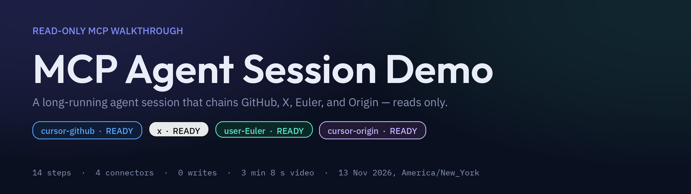
</p>

<p align="center">
  
  
  
  
  
  
  
</p>

A recorded, **read-only** long-running agent session that chains four connected MCP connectors — GitHub, X, Euler, and Origin — into one walkthrough, logs every step, and turns the session into a polished video.

This tree is a **local git repository only**. No GitHub remote has been created and nothing has been pushed. The intended home, once Lex approves a new storage location, is **`EmergentTechGroup/mcp-agent-session-demo`**.

## Watch the session

<!--
TODO(user-attachments): After Lex approves and this repo exists on GitHub, open
the web README editor, drag media/demo.mp4 into the text area, and replace the
GIF preview below with the bare URL GitHub inserts
(https://github.com/user-attachments/assets/<uuid>) on its own line, with a
blank line above and below. That user-attachments URL is the only form GitHub
will play inline in a README. Do not point a <video> tag at
raw.githubusercontent.com or at a relative repo path — GitHub's CSP media-src
does not allowlist raw.githubusercontent.com, and the raw endpoint serves
MP4s as Content-Type: application/octet-stream with
X-Content-Type-Options: nosniff (and often Content-Disposition: attachment),
so the browser will not play them. See "How the video is shown in this
README" below for sources.
-->

[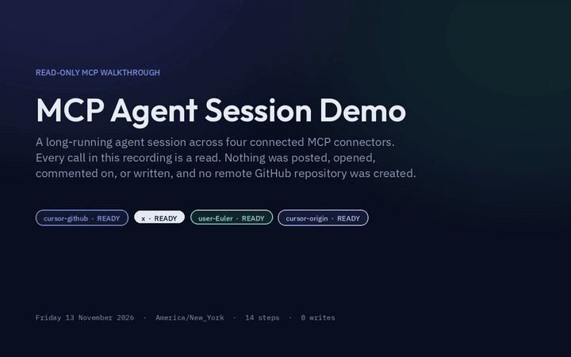](media/demo.mp4)

*Animated preview of the recorded session, sped up 12× with an ffmpeg `palettegen` / `paletteuse` two-pass (15.8 seconds, 720×450, 8 fps, **1.59 MB**, under GitHub's 10 MB image limit). Click the GIF to open the full H.264 video (`media/demo.mp4`, 1280×800, 30 fps, **3 minutes 8.6 seconds**, **2.90 MB**). On GitHub, that relative link opens the file's blob page, which has a player.*

[Full video (mp4)](media/demo.mp4) · [Poster frame](media/poster.png) · [Uncut screen recording](media/raw/session-raw.mp4)

## Why this repo exists

Teams building AI agents that talk to real tools through MCP need a concrete reference for what a **long-running, multi-connector session** looks like — not a single API call, and not a write-heavy demo that leaves tickets and posts behind.

This repository is that reference:

- An agent **chains four live MCP connectors in one session**, passing public context from one into the next (a GitHub search for MCP leads to reading the official Python SDK, then to X trends and post counts on the same topic, then to Euler's public help centre and an Origin namespace listing).
- Every call is **strictly read-only**. Nothing is posted, commented, labelled, opened, or created on any connector.
- The work is **visible and reproducible**: a live dashboard was recorded on the box display, a structured step log was written as the agent went, and a polished video plus an optimized GIF preview were rendered from that real log — no invented numbers.
- Privacy is explicit: emails, tokens, Euler identity fields, and Origin namespace slugs were redacted or never requested.

Use it as a pattern for your own agent demos: discover tools, plan a safe read-only chain, log facts, record the session, and ship a README that actually plays a preview once the repo is on GitHub.

## Architecture

How the agent, the on-screen dashboard, the recorder, and the four MCP connectors relate:

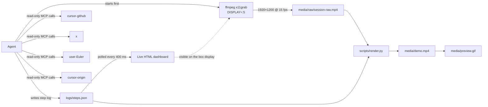

The actual call sequence, with the real tools that ran on 13 November 2026:

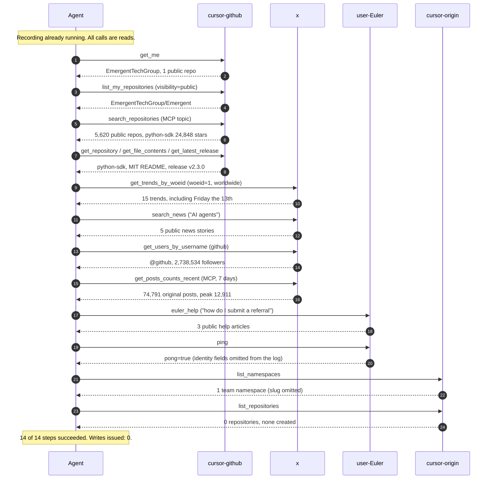

## Connectors

All four namespaces were inspected with `GetDynamicTools` first. Every one reported `namespaceStatus: ready` and was used. None were skipped.

| Namespace | Status | Tools called (reads only) | What came back (from the log) |
|-----------|--------|---------------------------|-------------------------------|
| `cursor-github` | ready | `get_me`, `list_my_repositories`, `search_repositories`, `get_repository`, `get_file_contents`, `get_latest_release` | Public account `EmergentTechGroup`; one public repo; 5,620 MCP search hits; official `python-sdk` at 24,848 stars, MIT, latest release **v2.3.0** |
| `x` | ready | `get_trends_by_woeid`, `search_news`, `get_users_by_username`, `get_posts_counts_recent` | 15 worldwide trends; 5 AI-agent news stories; `@github` with 2,738,534 followers; **74,791** original MCP posts in 7 days |
| `user-Euler` | ready | `euler_help`, `ping` | 3 public help articles on submitting a referral; `pong=true` (identity redacted) |
| `cursor-origin` | ready | `list_namespaces`, `list_repositories` | 1 team namespace (slug omitted); **0** repositories; nothing created |

## Session timeline

Durations are `finished_at − started_at` in [logs/steps.json](logs/steps.json), America/New_York, Friday 13 November 2026. The first tool started at 12:12:57 EST; the last finished at 12:15:30 EST. Gaps between bars are the few seconds the live dashboard was held on screen so the recording could show each result.

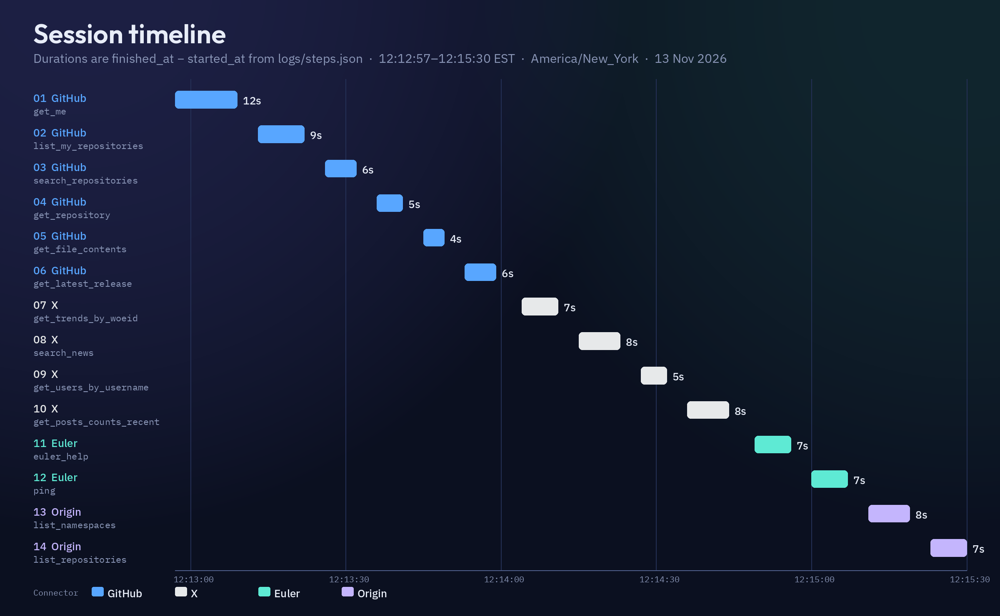

*Session timeline generated from the real log by `scripts/make_graphics.py`. A scalable companion is [media/timeline.svg](media/timeline.svg).*

## Step table

| # | Time (EST) | Duration | Connector | Tool | Result (from the log) |
|---|------------|----------|-----------|------|------------------------|
| 1 | 12:13:09 | 12 s | GitHub | `get_me` | Connected as **EmergentTechGroup** (User, 1 public repo, 0 followers). Email was not present; none recorded. |
| 2 | 12:13:22 | 9 s | GitHub | `list_my_repositories` | `visibility=public`: **1** repo, `EmergentTechGroup/Emergent` (public, 0 stars, created 09:45 AM EST). Private repos were not requested. |
| 3 | 12:13:32 | 6 s | GitHub | `search_repositories` | Query `model context protocol MCP topic:mcp`, sort stars: **5,620** repos. Top: `python-sdk` 24,848 stars; `mcp-for-beginners` 17,644; `typescript-sdk` 13,760; `fastapi_mcp` 12,031; `tyk` 10,883. |
| 4 | 12:13:41 | 5 s | GitHub | `get_repository` | `modelcontextprotocol/python-sdk`: public, Python, MIT, default `main`, **24,848** stars, **4,124** forks, 411 open issues, last push 2026-11-05 8:38 AM EST. |
| 5 | 12:13:49 | 4 s | GitHub | `get_file_contents` | `README.md`: “Python implementation of the Model Context Protocol (MCP)”; Python 3.11+; `uv add "mcp[cli]"`; MIT; docs at py.sdk.modelcontextprotocol.io. |
| 6 | 12:13:59 | 6 s | GitHub | `get_latest_release` | **v2.3.0**, published 2026-10-02 6:02 PM EDT by `maxisbey`. “Mostly fixes, plus three new options.” `httpx2 >= 2.10.0` now required. |
| 7 | 12:14:11 | 7 s | X | `get_trends_by_woeid` | `woeid=1` (Worldwide), 15 trends. Included **Friday the 13th**, **Microsoft**, and **ChatGPT Wallet**. Tweet counts were not returned. |
| 8 | 12:14:23 | 8 s | X | `search_news` | Query `"AI agents"`, 5 stories in 7 days: healthcare admin agent, coding harnesses (Addy Osmani; Terminal-Bench 2.0 varied by up to 18.4 points), Coinbase CEO workflow, trading-agent credit scores. |
| 9 | 12:14:32 | 5 s | X | `get_users_by_username` | **@github** (id 13334762), verified business, San Francisco, **2,738,534** followers, 11,071 posts, created 2008-02-10 11:41 PM EST. |
| 10 | 12:14:44 | 8 s | X | `get_posts_counts_recent` | `MCP OR "model context protocol" -is:retweet`: **74,791** original posts in 7 days (12:14 PM EST 6 Nov → 12:14 PM EST 13 Nov). Peak **12,911** on 11 Nov 2026 (UTC day). |
| 11 | 12:14:56 | 7 s | Euler | `euler_help` | Query “how do I submit a referral”: **3** public articles ([registering a deal](https://support.eulerapp.com/en/articles/16564291-submitting-a-referral-or-registering-a-deal), [Slack `/referral`](https://support.eulerapp.com/en/articles/14061062-euler-slack-app-partner-guide), [referrals sent to you](https://support.eulerapp.com/en/articles/16564434-referrals-sent-to-you)). |
| 12 | 12:15:07 | 7 s | Euler | `ping` | `pong=true`, echo matched `mcp-agent-session-demo`, role/scope `partner`, client `Cursor`. User id, email, company id, partner ids, and session id were **omitted**. |
| 13 | 12:15:19 | 8 s | Origin | `list_namespaces` | **1** team namespace, `viewerCanCreateRepositories: true` (recorded as a capability only). Slug and id omitted. Nothing was created. |
| 14 | 12:15:30 | 7 s | Origin | `list_repositories` | **0** repositories. `get_repository` was not called. `create_repository` was not invoked. |

Full prose summaries: [logs/steps.md](logs/steps.md) and [logs/steps.json](logs/steps.json).

## Media

Every file under [`media/`](media/) is listed here, with a caption. Images are shown inline; the two videos are linked (see [How the video is shown](#how-the-video-is-shown-in-this-readme) for why a `<video>` tag is not used).

### Preview, video, and stills

[](media/demo.mp4)

***`media/preview.gif`** — 12×-speed animated preview (720×450, 8 fps, 15.8 s, 1.59 MB) built with ffmpeg `palettegen` + `paletteuse`. Click to open the full video.*

[**`media/demo.mp4`**](media/demo.mp4) — Final polished video: 1280×800, H.264 yuv420p, 30 fps, 3 minutes 8.6 seconds, 2.90 MB. Title card + cropped raw session with factual captions + end card. No audio. Under 50 MB, no Git LFS.

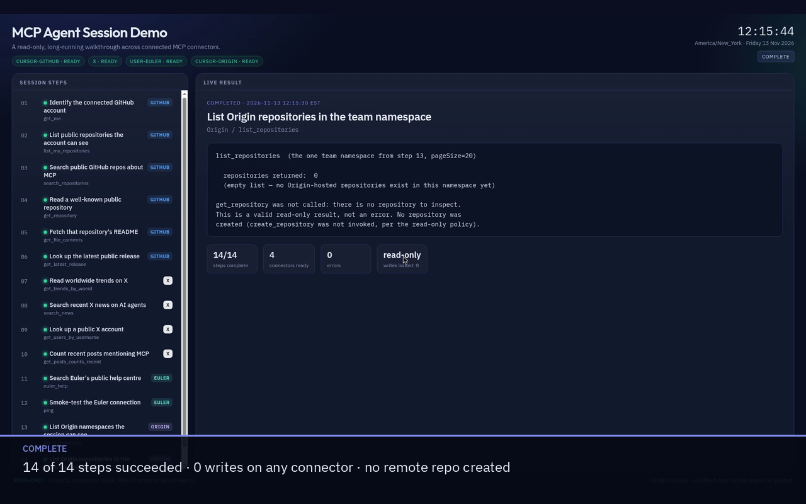

***`media/poster.png`** — Poster frame (1280×800, 0.27 MB) taken from the completed-dashboard tail of the body, with the caption “14 of 14 steps succeeded · 0 writes on any connector · no remote repo created.”*

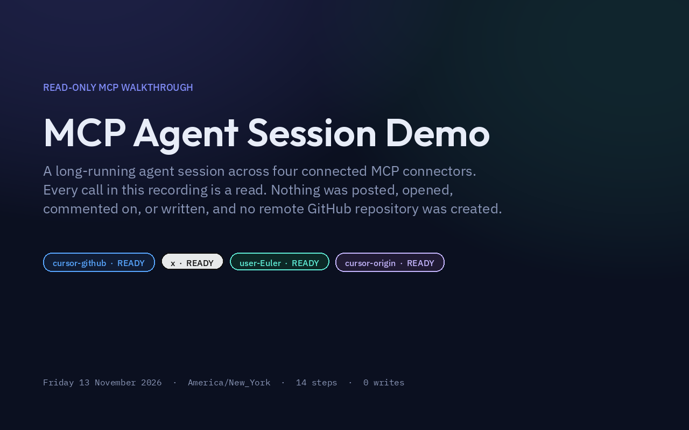

***`media/title.png`** — Opening title card used in `demo.mp4`: “MCP Agent Session Demo”, the four ready connectors, and the 13 November 2026 / America/New_York line.*

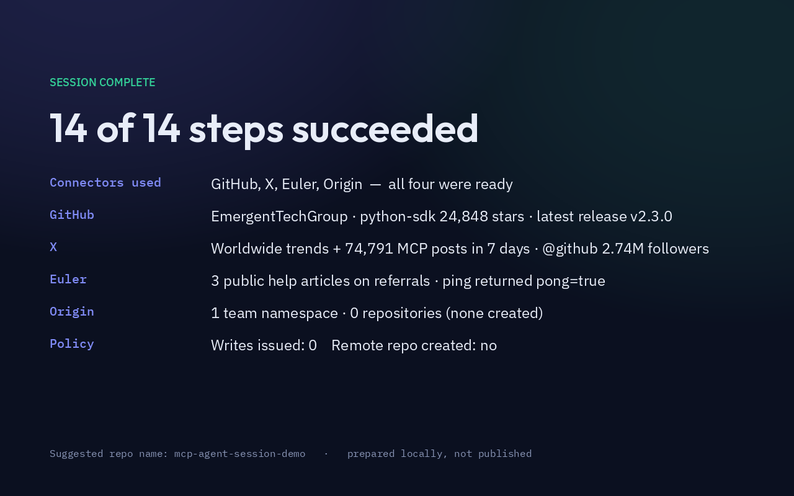

***`media/end.png`** — Closing card used in `demo.mp4`, summarizing the real results from each connector and restating the read-only policy.*


***`media/banner.png`** — README header banner (2560×720) generated by `scripts/make_graphics.py`, matching the video art direction.*

### Timeline


***`media/timeline.png`** — Gantt-style chart of wall-clock step durations from the log (2400×1480). Companion SVG: [media/timeline.svg](media/timeline.svg).*

### Uncut recording

[**`media/raw/session-raw.mp4`**](media/raw/session-raw.mp4) — Uncut ffmpeg x11grab of the box display before titles and captions: 1920×1200, 15 fps, 2 minutes 56.6 seconds, 6.46 MB, `DISPLAY=:5`.

### Caption bars

These are the lower-thirds burned into the polished video, cropped from the full-frame overlays in [`media/captions/`](media/captions/) (the 1280×800 transparent PNGs `render.py` composites). Every line is a factual shortening of that step's logged summary.

| Bar | Caption |
|-----|---------|
| 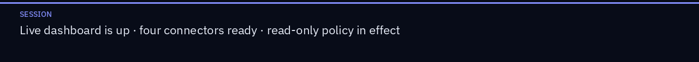 | **00** — Session starting: four connectors ready, read-only policy in effect. |
|  | **01 GitHub `get_me`** — Connected as EmergentTechGroup · 1 public repository · email not present. |
| 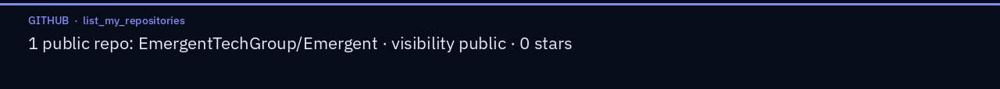 | **02 GitHub `list_my_repositories`** — 1 public repo: EmergentTechGroup/Emergent · visibility public · 0 stars. |
|  | **03 GitHub `search_repositories`** — 5,620 public MCP repos · top: python-sdk 24,848 stars, mcp-for-beginners 17,644 stars. |
| 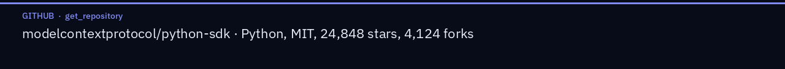 | **04 GitHub `get_repository`** — modelcontextprotocol/python-sdk · Python, MIT, 24,848 stars, 4,124 forks. |
|  | **05 GitHub `get_file_contents`** — README: official Python MCP SDK · Python 3.11+ · `uv add "mcp[cli]"` · MIT. |
|  | **06 GitHub `get_latest_release`** — Latest release v2.3.0 · published 2026-10-02 6:02 PM EDT · mostly fixes. |
|  | **07 X `get_trends_by_woeid`** — 15 worldwide trends · including Friday the 13th, Microsoft, ChatGPT Wallet. |
| 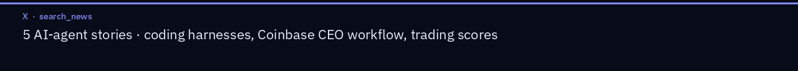 | **08 X `search_news`** — 5 AI-agent stories · coding harnesses, Coinbase CEO workflow, trading scores. |
| 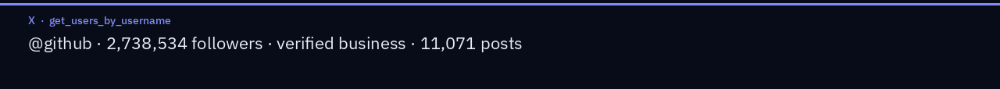 | **09 X `get_users_by_username`** — @github · 2,738,534 followers · verified business · 11,071 posts. |
|  | **10 X `get_posts_counts_recent`** — 74,791 original MCP posts in 7 days · peak 12,911 on 11 Nov 2026 (UTC). |
|  | **11 Euler `euler_help`** — 3 public help articles on submitting a referral · portal and Slack `/referral`. |
|  | **12 Euler `ping`** — pong=true, echo matched · authenticated partner-scoped Cursor client · IDs omitted. |
|  | **13 Origin `list_namespaces`** — 1 team namespace visible · slug and id omitted · create capability unused. |
|  | **14 Origin `list_repositories`** — 0 repositories in that namespace · get_repository skipped · nothing created. |
| 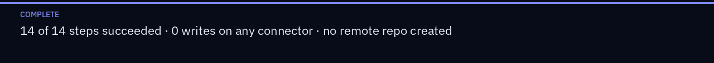 | **15 Complete** — 14 of 14 steps succeeded · 0 writes on any connector · no remote repo created. |

The matching full-frame overlays (used by the renderer, mostly transparent) live at `media/captions/00.png` … `media/captions/15.png`.

## How it was recorded and rendered

1. A live HTML dashboard ([`dashboard/index.html`](dashboard/index.html)) was served from `127.0.0.1:8765` and opened once, as a Chrome app window, on the box display (`DISPLAY=:5`, **1920×1200**). The page polls `logs/steps.json` every 400 ms. No GUI automation (`xdotool`, CDP, Playwright, or browser driving) was used.
2. [`scripts/record.sh`](scripts/record.sh) started **before** the first MCP call:

   ```bash
   ffmpeg -f x11grab -video_size 1920x1200 -framerate 15 -draw_mouse 1 -i :5.0 \
     -c:v libx264 -preset ultrafast -pix_fmt yuv420p -crf 23 \
     media/raw/session-raw.mp4
   ```

   The brief mentioned 1280×800; the box display is natively 1920×1200, which is what was captured. The final video is scaled to 1280×800.
3. Each MCP call was a documented read. After every result, [`scripts/append_step.py`](scripts/append_step.py) updated the JSON and markdown logs with a timestamp (America/New_York), connector, tool, and a redacted summary. The dashboard showed those updates on screen.
4. Recording was stopped with `SIGINT` so the MP4 finalized cleanly. Raw duration: **176.6 seconds**.
5. [`scripts/render.py`](scripts/render.py) drew a title card and an end card whose facts come from the log, cropped the XFCE chrome from the raw take, overlaid the caption bars above, and concatenated title (6 s) + body (176.6 s) + end (6 s) as H.264, CRF 20, `+faststart`. Every caption is a factual shortening of that step's logged summary.
6. [`scripts/make_preview_gif.sh`](scripts/make_preview_gif.sh) built the 12× GIF with a two-pass `palettegen` / `paletteuse`. [`scripts/make_graphics.py`](scripts/make_graphics.py) built the banner, the timeline, and the cropped caption bars.

## How to reproduce

You need a machine with the same four MCP connectors connected, `ffmpeg`, Python 3 with Pillow, a browser, and an X display.

```bash
# 1. Serve the dashboard and open it on the display you will record
python3 scripts/serve-dashboard.py 8765 &
DISPLAY=:5 google-chrome --app=http://127.0.0.1:8765/ --user-data-dir=/tmp/mcp-demo-chrome &

# 2. Start the screen recording first
./scripts/record.sh start media/raw/session-raw.mp4

# 3. Run the same read-only MCP tools, and after each call:
python3 scripts/append_step.py --n N --status running --session-status live
python3 scripts/append_step.py --n N --status ok --summary "…factual redacted result…"

# 4. Stop, render the video, then rebuild the GIF and graphics
./scripts/record.sh stop
python3 scripts/render.py
./scripts/make_preview_gif.sh
python3 scripts/make_graphics.py
```

Exact tool arguments used in this run are in the step summaries (for example `search_repositories` query `model context protocol MCP topic:mcp`, X trends `woeid=1`, news query `AI agents`, post counts `MCP OR "model context protocol" -is:retweet`). Re-running will produce **new** live figures; do not copy this video's numbers onto a later run.

## How the video is shown in this README

The approach that **works once this tree is pushed**, without a browser upload, is:

1. An optimized **animated GIF** (`media/preview.gif`, 1.59 MB) embedded with ordinary Markdown image syntax, which GitHub renders and autoplays as an image.
2. That GIF is wrapped in a **link to `media/demo.mp4`**. On GitHub the relative link opens the file's blob page, where GitHub's file viewer can play the H.264 file. The mp4 itself also stays in the repo for download.

A `<video>` tag pointing at `raw.githubusercontent.com` (or at a relative repo path) is **not** included, because it does not play inline:

- GitHub's README HTML sanitizer has been observed stripping or emptying `<video>` tags whose `src` is `raw.githubusercontent.com` ([kubesplaining#60](https://github.com/0hardik1/kubesplaining/pull/60), May 2026).
- The raw endpoint serves `.mp4` as `Content-Type: application/octet-stream` with `X-Content-Type-Options: nosniff`, and often `Content-Disposition: attachment`, so a browser will not feed it to a media element ([Bobo Chen, 2026](https://bobochen.dev/blog/github-readme-video-embed-last-mile/); [aidemo EMBEDS.md](https://github.com/tandryukha/aidemo/blob/main/docs/EMBEDS.md)).
- github.com's Content-Security-Policy `media-src`, checked on 3 November 2026, allowlists `github.com`, `user-images.githubusercontent.com`, `private-user-images.githubusercontent.com`, and related asset hosts — not `raw.githubusercontent.com` ([Docs MD, 3 Nov 2026](https://docs-md.com/github-readme-viewer/embed-video-in-readme); [twc commit 4686f71](https://github.com/randyharrogates/twc/commit/4686f71839d1e7a019c59c46ee23aca2e0a2a7c2), April 2026).

The **best** inline player — a bare `https://github.com/user-attachments/assets/<uuid>` URL on its own line — is produced only when someone drags an MP4 into GitHub's web editor (or an issue/PR comment). Official docs: [Attaching files](https://docs.github.com/en/get-started/writing-on-github/working-with-advanced-formatting/attaching-files) (H.264 recommended; 10 MB video limit on a free plan, 100 MB on a paid plan). This demo file is 2.90 MB, so it fits the free-plan limit. That upload is a **TODO** in the HTML comment above the GIF, to be done after Lex approves the remote and someone can use the web editor. There is no API-only path to a user-attachments video URL for a README.

GitHub Pages would serve the same MP4 with `Content-Type: video/mp4` and can work in a `<video>` tag on a Pages site, but Pages is a published site, not something this local package enables.

## Safety and privacy

- **Read-only.** Every connector call in this session is a documented read. Euler `ping` and Origin `list_*` do not create or modify records. GitHub listing used `visibility=public`. X calls were public reads (trends, news, a public user, post counts). Writes issued: **0**.
- **Redactions.** Euler `ping` returned a user id, email, company id, partner ids, and a session id; those were received and **deliberately omitted** from the log, the video, and this README. The Origin namespace slug and id were omitted because Origin-hosted namespaces are not a public web surface. No tokens or private repository names appear.
- **Public data only** after the account listing: the deep GitHub work is on `modelcontextprotocol/python-sdk`; the X account is the public `@github`.
- **No remote.** This tree has no `git remote`. Nothing was pushed. Creating `EmergentTechGroup/mcp-agent-session-demo` still requires Lex's approval.

## Repository structure

```
.
├── README.md                 This document
├── LICENSE                   MIT, Copyright (c) 2026 EmergentTechGroup
├── .gitignore
├── index.html                Symlink to dashboard/index.html (local live viewer)
├── dashboard/
│   └── index.html            Live session dashboard (polls the step log)
├── logs/
│   ├── steps.json            Structured step log (source of truth)
│   └── steps.md              The same log as a markdown table
├── media/
│   ├── banner.png            README header banner
│   ├── preview.gif           12×-speed animated preview (1.59 MB)
│   ├── demo.mp4              Polished 1280×800 H.264 video (2.90 MB)
│   ├── poster.png            Poster frame from the completed dashboard
│   ├── title.png             Video title card
│   ├── end.png               Video end card
│   ├── timeline.png          Step-duration chart from the real log
│   ├── timeline.svg          Scalable companion to the chart
│   ├── caption-bars/         Cropped lower-thirds (00–15)
│   ├── captions/             Full-frame caption overlays used by the renderer
│   └── raw/
│       └── session-raw.mp4   Uncut 1920×1200 x11grab (6.46 MB)
└── scripts/
    ├── record.sh             Start/stop ffmpeg x11grab
    ├── serve-dashboard.py    Local HTTP server for the dashboard
    ├── append_step.py        Update logs/steps.json and steps.md
    ├── render.py             Build media/demo.mp4 and poster.png
    ├── render.sh             Thin wrapper around render.py
    ├── make_preview_gif.sh   Two-pass palettegen GIF
    └── make_graphics.py      Banner, timeline, caption bars
```

## License

[MIT](LICENSE) © 2026 EmergentTechGroup.
